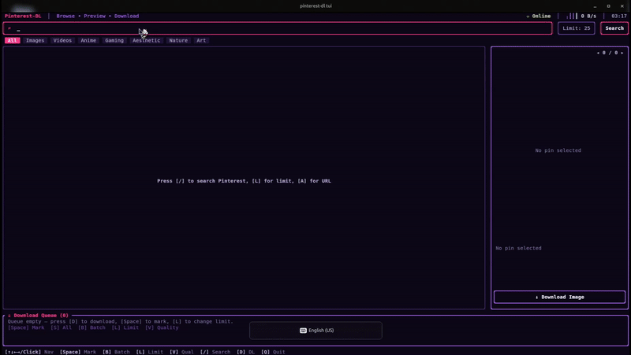
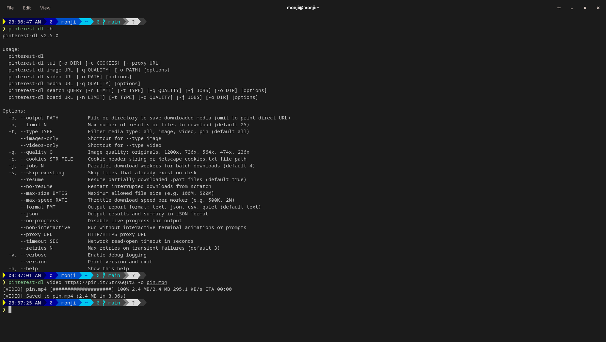

<div align="center">


# pinterest-dl

**لینک مستقیم عکس و ویدیو از پینترست بگیر پین جستجو کن، محتوای بورد رو بکش و رسانه دانلود کن هم با Ruby هم از خط فرمان**

[](https://rubygems.org/gems/pinterest-dl)
[](https://rubygems.org/gems/pinterest-dl)
[](https://github.com/monji024/pinterest-dl)
[](https://github.com/monji024/pinterest-dl/actions/workflows/ci.yml)
[](LICENSE)
[](https://www.ruby-lang.org/)

**زبان‌ ها:** [English](README.md) | [فارسی](README.fa.md)

</div>

---

پینترست API عمومی برای لینک مستقیم رسانه یا گشتن دسته‌ای توی بوردها نمیده `pinterest-dl` همین کار رو میکنه لینک واقعی `i.pinimg.com` و `v.pinimg.com` رو از صفحه پین و endpointهای وب پینترست میکشه بیرون وابستگی خارجی هم نداره

> اگه پینترست برات فیلتره از پروکسی استفاده کن (`--proxy` یا `config.proxy`)

## فهرست

- [دمو](#دمو)
- [ویژگی‌ها](#ویژگیها)
- [تصاویر](#تصاویر)
- [نصب](#نصب)
- [شروع سریع](#شروع-سریع)
- [استفاده از کتابخانه](#استفاده-از-کتابخانه)
- [پیکربندی](#پیکربندی)
- [مرجع خط فرمان](#مرجع-خط-فرمان)
- [مدیریت خطا](#مدیریت-خطا)
- [سوال‌های پرتکرار](#سوالهای-پرتکرار)
- [توسعه](#توسعه)
- [مجوز](#مجوز)

## دمو

<div align="center">
  
</div>

## ویژگی‌ها

| | ویژگی | توضیح |
|---|-------|------|
|  | **استخراج مستقیم رسانه** | لینک عکس با کیفیت‌های مختلف (`originals`, `1200x`, `736x`, `564x`, `474x`, `236x`) و بهترین `.mp4` رو می‌ده. با لینک معمولی پین، زیردامنه‌های کشوری و `pin.it` کار می‌کنه. |
|  | **جستجو و بوردها** | توی پینترست سرچ کن یا پین ‌های یک بورد/بخش رو بگیر صفحه‌بندی خودکار داره، تکراری ‌ها رو فیلتر می‌کنه و اگه لازم باشه از HTML هم استفاده می‌کنه. |
|  | **دانلود قابل اعتماد** | اول با پسوند `.part` مینویسه بعد کامل که شد اسمش رو عوض میکنه. Resume داره (`206` / `416`)، Content-Type رو چک می‌کنه، محدودیت حجم و سرعت می‌ذاره و چندتا رو با هم دانلود می‌کنه. |
|  | **امنیت پیشفرض** | جلوی SSRF رو میگیره کوکی فقط برای دامنه‌ های پینترست میره هدرهای حساس موقع ریدایرکت پاک می‌شن و توکن‌ها توی لاگ نمی‌آن. |
|  | **نشست ‌های ایزوله** | با `PinterestDL.configure` تنظیمات سراسری بده یا با `PinterestDL.session` کلاینت جدا بساز. |

## تصاویر

<div align="center">
  
</div>

## نصب

```bash
gem install pinterest-dl
```

یا بذار توی Gemfile:

```ruby
gem 'pinterest-dl'
```

Ruby ۳.۰ به بالا وابستگی خارجی نداره

## شروع سریع

### رابط کاربری تعاملی (TUI)

گالری، پیش ‌نمایش زنده، انتخاب کیفیت، ماوس و دانلود دسته ای:

```bash
pinterest-dl tui
# یا فقط pinterest-dl رو توی ترمینال واقعی بزن
```

متغیرهای پروکسی (`HTTPS_PROXY`, `HTTP_PROXY`, `ALL_PROXY`) و فایل محلی `cookies.txt` خودکار خونده میشن

**پیش‌ نمایش عکس** به ترمینالت بستگی داره:

- **تصویر کامل:** Kitty، Ghostty، WezTerm، Konsole (پروتکل Kitty)، iTerm2 / Tabby / Hyper / Warp (Inline Images)، Windows Terminal / Foot / mlterm / Contour (Sixel با `chafa` یا `img2sixel`)
- **ترمینال ‌های معمولی X11** (GNOME Terminal، Pop!_OS Terminal، XFCE4 Terminal، Alacritty): برای پیش‌ نمایش تمیز `ueberzugpp` بذار بدونش با half-block از طریق `ffmpeg`، ImageMagick، `chafa`، Pillow یا `djpeg` کار میکنه

نصب اختیاری روی Ubuntu / Pop!_OS:

```bash
echo 'deb http://download.opensuse.org/repositories/home:/justkidding/xUbuntu_26.04/ /' | sudo tee /etc/apt/sources.list.d/home:justkidding.list
curl -fsSL https://download.opensuse.org/repositories/home:justkidding/xUbuntu_26.04/Release.key | gpg --dearmor | sudo tee /etc/apt/trusted.gpg.d/home_justkidding.gpg > /dev/null
sudo apt update
sudo apt install ueberzugpp
```

*(برای نسخه‌های قدیمی‌تر `xUbuntu_24.04` یا `xUbuntu_22.04` بذار)*

### خط فرمان

```bash
# فقط لینک مستقیم
pinterest-dl image https://www.pinterest.com/pin/1234567890123456789/
pinterest-dl video https://pin.it/3vYQ7zmM5

# دانلود (با نوار پیشرفت)
pinterest-dl image https://www.pinterest.com/pin/1234567890123456789/ -o pin.jpg
pinterest-dl video https://pin.it/3vYQ7zmM5 -o video.mp4

# هم عکس هم ویدیو به صورت JSON
pinterest-dl media https://www.pinterest.com/pin/1234567890123456789/

# سرچ و دانلود ۵۰ نتیجه با ۶ نخ
pinterest-dl search "architectural photography" -n 50 -j 6 -o ./downloads

# فقط ویدیوهای یک بورد، فایل‌های موجود رد بشن
pinterest-dl board https://www.pinterest.com/username/board-name/ --videos-only -n 100 -s -o ./videos
```

### کتابخانه Ruby

```ruby
require 'pinterest-dl'

image_url = PinterestDL.get_image_url('https://www.pinterest.com/pin/1234567890123456789/')
video_url = PinterestDL.get_video_url('https://www.pinterest.com/pin/1234567890123456789/')
media     = PinterestDL.get_media('https://www.pinterest.com/pin/1234567890123456789/', quality: :'736x')
# => { image_url: "https://i.pinimg.com/736x/...", video_url: nil }

PinterestDL.download(image_url, path: 'downloads/pin.jpg', resume: true)
```

## استفاده از کتابخانه

### نشست‌های ایزوله

وقتی چند تنظیمات یا چند اکانت داری و نمیخوای config سراسری دست بخوره:

```ruby
session = PinterestDL.session(
  cookies: File.expand_path('~/cookies.txt'),
  quality: :'1200x',
  concurrency: 6,
  max_speed: '2M'
)

pins = session.board('https://www.pinterest.com/username/board-name/', limit: 50)
report = session.download_batch(pins, dir: './downloads', collision_strategy: :rename)
```

### جستجو و بوردها

```ruby
# هر پین یک hash است: id, pin_url, title, description, creator, image_url, video_url
pins = PinterestDL.search('minimalist poster', limit: 25, type: :all)
image_urls = PinterestDL.search_images('sunset', limit: 10)
video_urls = PinterestDL.search_videos('motion graphics', limit: 5)

board_pins   = PinterestDL.board('https://www.pinterest.com/username/board-name/', limit: 100)
section_pins = PinterestDL.board('https://www.pinterest.com/username/board-name/section-slug/', limit: 50)
```

### دانلود دسته ‌ای

`download_batch` آرایه ‌ای از URL یا pin hash میگیره و `PinterestDL::DownloadReport` برمیگردونه (هم method و هم Hash کار میکنه):

```ruby
urls = PinterestDL.search_images('mountains', limit: 40)

report = PinterestDL.download_batch(
  urls,
  dir: './downloads',
  concurrency: 4,
  resume: true,
  deduplicate: true,
  collision_strategy: :rename # :rename, :skip, or :overwrite
) do |done, total, url|
  warn "Progress: #{done}/#{total} (#{url})"
end

puts "موفق: #{report.succeeded.size}"
puts "رد شده: #{report.skipped.size}"
puts "ناموفق: #{report.failed.size}"
puts "بایت: #{report.bytes_downloaded}"
```

## پیکربندی

```ruby
PinterestDL.configure do |c|
  c.cookies             = File.expand_path('~/cookies.txt') # یا 'sessionid=...; csrftoken=...'
  c.quality             = :originals  # :originals, :"1200x", :"736x", :"564x", :"474x", :"236x"
  c.open_timeout        = 10
  c.read_timeout        = 20
  c.write_timeout       = 20
  c.max_retries         = 3
  c.retry_wait          = 1.0
  c.max_retry_wait      = 30.0
  c.retry_jitter        = 0.25
  c.rate_limit_interval = 0.5
  c.concurrency         = 4
  c.overwrite           = true
  c.resume              = true
  c.deduplicate         = true
  c.collision_strategy  = :rename     # :rename, :skip, or :overwrite
  c.max_file_size       = 500 * 1024 * 1024
  c.max_speed           = nil         # مثلا '500K' یا '2M'
  c.verify_content_type = true
  c.proxy               = nil         # پیش ‌فرض از HTTPS_PROXY / HTTP_PROXY
  c.max_cache_entries   = 256
end
```

## مرجع خط فرمان

```text
Usage:
  pinterest-dl image URL [-q QUALITY] [-o PATH] [options]
  pinterest-dl video URL [-o PATH] [options]
  pinterest-dl media URL [-q QUALITY] [options]
  pinterest-dl search QUERY [-n LIMIT] [-t TYPE] [-q QUALITY] [-j JOBS] [-o DIR] [options]
  pinterest-dl board URL [-n LIMIT] [-t TYPE] [-q QUALITY] [-j JOBS] [-o DIR] [options]

Options:
  -o, --output PATH          مسیر فایل یا پوشه (بدونش فقط URL چاپ میشه)
  -n, --limit N              حداکثر نتایج (پیش‌ فرض ۲۵)
  -t, --type TYPE            all, image, video, pin (پیش ‌فرض all)
      --images-only          معادل --type image
      --videos-only          معادل --type video
  -q, --quality Q            originals, 1200x, 736x, 564x, 474x, 236x
  -c, --cookies STR|FILE     هدر کوکی یا فایل cookies.txt
  -j, --jobs N               تعداد نخ موازی (پیش‌ فرض ۴)
  -s, --skip-existing        فایل‌ های موجود رو رد کن
      --resume               ادامه فایل ‌های .part (پیش‌ فرض روشنه)
      --no-resume            از اول شروع کن
      --max-size BYTES       حداکثر حجم (مثل 100M, 500M)
      --max-speed RATE       محدودیت سرعت هر worker (مثل 500K, 2M)
      --format FMT           text, json, csv, quiet (پیش‌ فرض text)
      --json                 خروجی JSON
      --no-progress          نوار پیشرفت رو خاموش کن
      --non-interactive      بدون انیمیشن و پرامپت
      --proxy URL            پروکسی http/https
      --timeout SEC          تایم‌ اوت شبکه
      --retries N            تلاش مجدد (پیش‌ فرض ۳)
  -v, --verbose              لاگ دیباگ
      --version              نسخه
  -h, --help                 راهنما
```

## مدیریت خطا

همه خطاها از `PinterestDL::Error` میان. معمولا `#url` و `#status_code` و `#cause_error` رو هم دارن

| خطا | کی رخ می‌ده |
|-----|-------------|
| `NotFoundError` | پین، بورد، بخش یا رسانه پیدا نشد |
| `AuthenticationError` | ۴۰۱ — کوکی لازم داری |
| `ForbiddenError` | ۴۰۳ — پینترست درخواست رو بسته |
| `RateLimitError` | ۴۲۹ — زیاد درخواست دادی (`#retry_after` اگه باشه) |
| `RangeNotSatisfiableError` | ۴۱۶ — بازه بایت نامعتبر |
| `TimeoutError` | تایم ‌اوت اتصال یا خوندن |
| `ConnectionError` | قطع سوکت، DNS، اتصال افتاده |
| `RedirectError` | حلقه ریدایرکت یا مقصد غیرقابل اعتماد |
| `InvalidURLError` / `SSRFError` | URL خراب یا آدرس خصوصی |
| `InvalidResponseError` | JSON خراب یا Content-Range نامعتبر |
| `FileTooLargeError` | بیشتر از `max_file_size` |
| `IncompleteDownloadError` | استریم زود تموم شد |
| `InvalidMediaError` | به‌ جای رسانه HTML/JSON اومد |
| `DiskSpaceError` | جا نیست یا پوشه قابل نوشتن نیست |

## سوال‌های پرتکرار

**پینترست اینجاست بسته.**  
`--proxy http://127.0.0.1:PORT` بده یا `HTTPS_PROXY` رو ست کن TUI خودش `HTTPS_PROXY` و `HTTP_PROXY` و `ALL_PROXY` رو هم میخونه.

**۴۰۱ یا ۴۰۳ می‌گیرم.**  
بعضی پین‌ ها و بوردها سشن لاگین میخوان یه `cookies.txt` به فرمت Netscape بساز و با `-c cookies.txt` بده (توی Ruby هم `c.cookies`) کوکی فقط برای خود پینترست میره نه CDN

**کدوم کیفیت؟**  
`:originals` فایل کامل است `1200x` و `736x` سبک‌ ترن و برای پیش‌ نمایش معمولا کافین ویدیو همیشه بهترین `.mp4` پینترست است.

**دانلود نصفه ادامه پیدا می‌کنه؟**  
بله فایل `.part` میمونه و از همون ‌جا ادامه میده مگر اینکه `--no-resume` بزنی

## توسعه

ببین [CONTRIBUTING.md](CONTRIBUTING.md)

```bash
bundle install
bundle exec rake test
bundle exec rake rubocop
```

## مجوز

[WTFPL](LICENSE) — [monji024](https://github.com/monji024)
