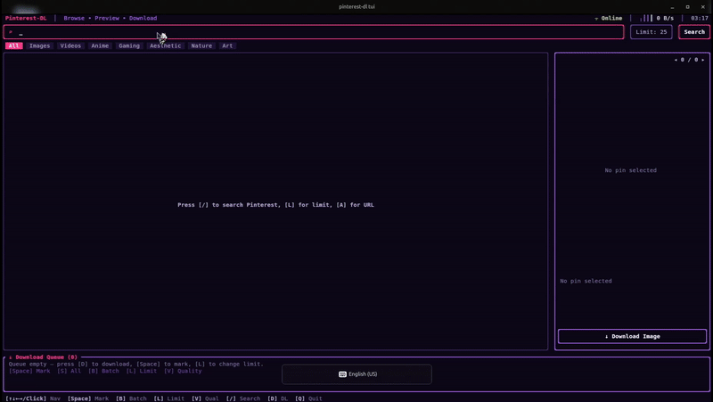
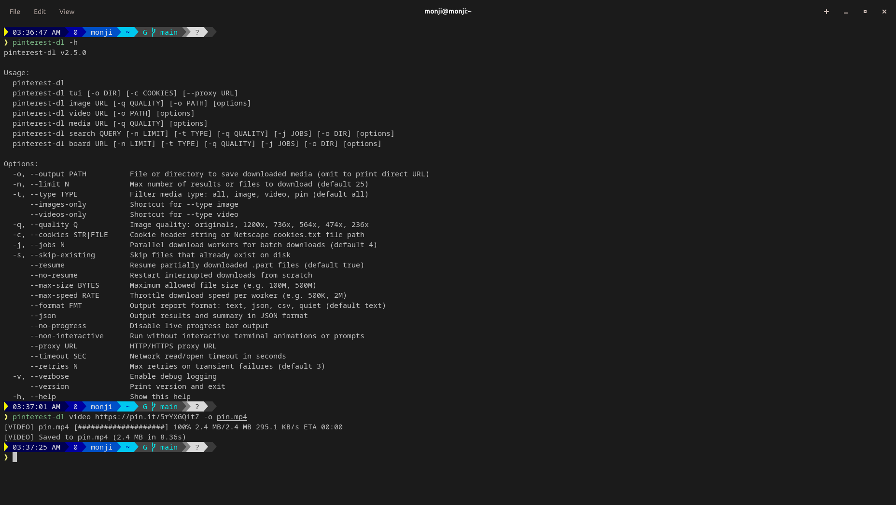

<div align="center">


# pinterest-dl

**Get direct image and video links from Pinterest. Search pins, grab board contents, and download media — from Ruby or the command line.**

[](https://rubygems.org/gems/pinterest-dl)
[](https://rubygems.org/gems/pinterest-dl)
[](https://github.com/monji024/pinterest-dl)
[](https://github.com/monji024/pinterest-dl/actions/workflows/ci.yml)
[](LICENSE)
[](https://www.ruby-lang.org/)

**Languages:** [English](README.md) | [فارسی](README.fa.md)

</div>

---

Pinterest doesn't give you a public API for direct media URLs or bulk board browsing. `pinterest-dl` fills that gap. It pulls real `i.pinimg.com` and `v.pinimg.com` links from pin pages and Pinterest web endpoints. Zero runtime gem dependencies.

> If Pinterest is blocked where you are, use a proxy (`--proxy` or `config.proxy`).

## Contents

- [Demo](#demo)
- [Features](#features)
- [Screenshots](#screenshots)
- [Installation](#installation)
- [Quick Start](#quick-start)
- [Library Usage](#library-usage)
- [Configuration](#configuration)
- [CLI Reference](#cli-reference)
- [Error Handling](#error-handling)
- [FAQ](#faq)
- [Development](#development)
- [License](#license)

## Demo

<div align="center">
  
</div>

## Features

| | Feature | Description |
|---|---------|-------------|
|  | **Direct media extraction** | Grabs original or resized image URLs (`originals`, `1200x`, `736x`, `564x`, `474x`, `236x`) and the highest-res `.mp4` video link. Works with normal pin URLs, country subdomains, and `pin.it` short links. |
|  | **Search and boards** | Search Pinterest or pull pins from a board/section. Handles pagination, filters duplicates, and falls back to embedded HTML when needed. |
|  | **Reliable downloading** | Streams to temporary `.part` files then renames them when done. Supports resume (`206 Partial Content` / `416`), Content-Type checks, size limits, speed throttling, and parallel workers. |
|  | **Security by default** | Blocks SSRF against private/loopback addresses. Cookies stay on Pinterest domains only. Sensitive headers get stripped on cross-domain redirects and tokens are redacted from logs. |
|  | **Isolated sessions** | Use global config with `PinterestDL.configure` or independent clients with `PinterestDL.session`. |

## Screenshots

<div align="center">
  
</div>

## Installation

```bash
gem install pinterest-dl
```

Or add it to your Gemfile:

```ruby
gem 'pinterest-dl'
```

Needs Ruby 3.0+ No extra runtime gems

## Quick Start

### Interactive TUI

Gallery browsing, live previews, quality picker, mouse support, and batch download:

```bash
pinterest-dl tui
# or just run `pinterest-dl` in a real terminal
```

Proxy env vars (`HTTPS_PROXY`, `HTTP_PROXY`, `ALL_PROXY`) and a local `cookies.txt` are picked up automatically.

**Image preview** depends on your terminal:

- **Full-res native images:** Kitty, Ghostty, WezTerm, Konsole (Kitty Graphics Protocol), iTerm2 / Tabby / Hyper / Warp (iTerm2 Inline Images), Windows Terminal / Foot / mlterm / Contour (Sixel via `chafa` or `img2sixel`)
- **Standard X11 terminals** (GNOME Terminal, Pop!_OS Terminal, XFCE4 Terminal, Alacritty): install `ueberzugpp` for clean overlays. Without it you get half-block previews through `ffmpeg`, ImageMagick, `chafa`, Pillow, or `djpeg`.

Optional install on Ubuntu / Pop!_OS:

```bash
echo 'deb http://download.opensuse.org/repositories/home:/justkidding/xUbuntu_26.04/ /' | sudo tee /etc/apt/sources.list.d/home:justkidding.list
curl -fsSL https://download.opensuse.org/repositories/home:justkidding/xUbuntu_26.04/Release.key | gpg --dearmor | sudo tee /etc/apt/trusted.gpg.d/home_justkidding.gpg > /dev/null
sudo apt update
sudo apt install ueberzugpp
```

*(Use `xUbuntu_24.04` or `xUbuntu_22.04` for older releases.)*

### CLI

```bash
# print the direct URL
pinterest-dl image https://www.pinterest.com/pin/1234567890123456789/
pinterest-dl video https://pin.it/3vYQ7zmM5

# download it (live progress bar)
pinterest-dl image https://www.pinterest.com/pin/1234567890123456789/ -o pin.jpg
pinterest-dl video https://pin.it/3vYQ7zmM5 -o video.mp4

# both image and video URLs as JSON
pinterest-dl media https://www.pinterest.com/pin/1234567890123456789/

# search and download 50 results with 6 workers
pinterest-dl search "architectural photography" -n 50 -j 6 -o ./downloads

# only videos from a board, skip files that already exist
pinterest-dl board https://www.pinterest.com/username/board-name/ --videos-only -n 100 -s -o ./videos
```

### Ruby Library

```ruby
require 'pinterest-dl'

image_url = PinterestDL.get_image_url('https://www.pinterest.com/pin/1234567890123456789/')
video_url = PinterestDL.get_video_url('https://www.pinterest.com/pin/1234567890123456789/')
media     = PinterestDL.get_media('https://www.pinterest.com/pin/1234567890123456789/', quality: :'736x')
# => { image_url: "https://i.pinimg.com/736x/...", video_url: nil }

PinterestDL.download(image_url, path: 'downloads/pin.jpg', resume: true)
```

## Library Usage

### Isolated Sessions

Handy when you need multiple configs or accounts without touching the global config:

```ruby
session = PinterestDL.session(
  cookies: File.expand_path('~/cookies.txt'),
  quality: :'1200x',
  concurrency: 6,
  max_speed: '2M'
)

pins = session.board('https://www.pinterest.com/username/board-name/', limit: 50)
report = session.download_batch(pins, dir: './downloads', collision_strategy: :rename)
```

### Search and Boards

```ruby
# each pin is a hash: id, pin_url, title, description, creator, image_url, video_url
pins = PinterestDL.search('minimalist poster', limit: 25, type: :all)
image_urls = PinterestDL.search_images('sunset', limit: 10)
video_urls = PinterestDL.search_videos('motion graphics', limit: 5)

board_pins   = PinterestDL.board('https://www.pinterest.com/username/board-name/', limit: 100)
section_pins = PinterestDL.board('https://www.pinterest.com/username/board-name/section-slug/', limit: 50)
```

### Batch Downloading

`download_batch` takes URLs or pin hashes and returns a `PinterestDL::DownloadReport` (method access or Hash access both work):

```ruby
urls = PinterestDL.search_images('mountains', limit: 40)

report = PinterestDL.download_batch(
  urls,
  dir: './downloads',
  concurrency: 4,
  resume: true,
  deduplicate: true,
  collision_strategy: :rename # :rename, :skip, or :overwrite
) do |done, total, url|
  warn "Progress: #{done}/#{total} (#{url})"
end

puts "Succeeded: #{report.succeeded.size}"
puts "Skipped:   #{report.skipped.size}"
puts "Failed:    #{report.failed.size}"
puts "Bytes:     #{report.bytes_downloaded}"
```

## Configuration

```ruby
PinterestDL.configure do |c|
  c.cookies             = File.expand_path('~/cookies.txt') # or 'sessionid=...; csrftoken=...'
  c.quality             = :originals  # :originals, :"1200x", :"736x", :"564x", :"474x", :"236x"
  c.open_timeout        = 10
  c.read_timeout        = 20
  c.write_timeout       = 20
  c.max_retries         = 3
  c.retry_wait          = 1.0
  c.max_retry_wait      = 30.0
  c.retry_jitter        = 0.25
  c.rate_limit_interval = 0.5
  c.concurrency         = 4
  c.overwrite           = true
  c.resume              = true
  c.deduplicate         = true
  c.collision_strategy  = :rename     # :rename, :skip, or :overwrite
  c.max_file_size       = 500 * 1024 * 1024
  c.max_speed           = nil         # e.g. '500K' or '2M'
  c.verify_content_type = true
  c.proxy               = nil         # falls back to HTTPS_PROXY / HTTP_PROXY
  c.max_cache_entries   = 256
end
```

## CLI Reference

```text
Usage:
  pinterest-dl image URL [-q QUALITY] [-o PATH] [options]
  pinterest-dl video URL [-o PATH] [options]
  pinterest-dl media URL [-q QUALITY] [options]
  pinterest-dl search QUERY [-n LIMIT] [-t TYPE] [-q QUALITY] [-j JOBS] [-o DIR] [options]
  pinterest-dl board URL [-n LIMIT] [-t TYPE] [-q QUALITY] [-j JOBS] [-o DIR] [options]

Options:
  -o, --output PATH          file or directory to save to (omit to print the URL)
  -n, --limit N              max results (default 25)
  -t, --type TYPE            all, image, video, pin (default all)
      --images-only          same as --type image
      --videos-only          same as --type video
  -q, --quality Q            originals, 1200x, 736x, 564x, 474x, 236x
  -c, --cookies STR|FILE     cookie header or Netscape cookies.txt
  -j, --jobs N               parallel workers (default 4)
  -s, --skip-existing        skip files that already exist
      --resume               resume .part files (default on)
      --no-resume            start over instead
      --max-size BYTES       max file size (e.g. 100M, 500M)
      --max-speed RATE       throttle per worker (e.g. 500K, 2M)
      --format FMT           text, json, csv, quiet (default text)
      --json                 JSON output
      --no-progress          hide the progress bar
      --non-interactive      no animations or prompts
      --proxy URL            http/https proxy
      --timeout SEC          network timeout
      --retries N            retries on transient failures (default 3)
  -v, --verbose              debug logging
      --version              print version
  -h, --help                 show help
```

## Error Handling

Everything inherits from `PinterestDL::Error`. Most of them expose `#url`, `#status_code`, and `#cause_error`.

| Exception | When it happens |
|-----------|-----------------|
| `NotFoundError` | pin, board, section, or media not found |
| `AuthenticationError` | 401 — need cookies |
| `ForbiddenError` | 403 — Pinterest blocked the request |
| `RateLimitError` | 429 — slow down (`#retry_after` when present) |
| `RangeNotSatisfiableError` | 416 — bad byte range |
| `TimeoutError` | connection or read timed out |
| `ConnectionError` | socket reset, DNS failure, dropped connection |
| `RedirectError` | redirect loop or untrusted redirect target |
| `InvalidURLError` / `SSRFError` | bad URL or private/loopback address |
| `InvalidResponseError` | bad JSON or invalid `206` Content-Range |
| `FileTooLargeError` | over `max_file_size` |
| `IncompleteDownloadError` | stream ended early |
| `InvalidMediaError` | got HTML/JSON instead of media |
| `DiskSpaceError` | no space or directory not writable |

## FAQ

**Pinterest is blocked here.**  
Pass `--proxy http://127.0.0.1:PORT` or set `HTTPS_PROXY`. The TUI also reads `HTTPS_PROXY` / `HTTP_PROXY` / `ALL_PROXY` on its own.

**I keep getting 401 or 403.**  
Some pins and boards want a logged-in session. Export a Netscape `cookies.txt` and pass `-c cookies.txt` (or `c.cookies` in Ruby). Cookies stay on Pinterest hosts. They never go to the CDN.

**Which quality should I use?**  
`:originals` is the full file. `1200x` and `736x` are smaller and fine for previews. Videos always come as the highest `.mp4` Pinterest serves.

**Will it resume a half-finished file?**  
Yes. Interrupted downloads leave a `.part` file and continue from there unless you pass `--no-resume`.

## Development

See [CONTRIBUTING.md](CONTRIBUTING.md)

```bash
bundle install
bundle exec rake test
bundle exec rake rubocop
```

## License

[WTFPL](LICENSE) — [monji024](https://github.com/monji024)
